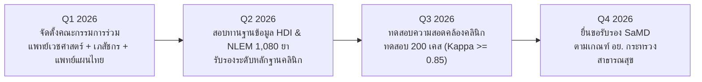

# ความเป็นไปได้ทางเทคนิคและการบริหารความเสี่ยง (Technical Feasibility & Risk Management)
**โครงการ:** TTM Smutthan Engine Platform — Hackathon 2026  
**ทีมพัฒนา:** **ทีม VejVivat (เวชวิวัฒน์) — Thai Medicine AI Innovation**  
**ลิงก์ระบบ Live Production:** [https://narisunt-ctrl.github.io/VejViVat/](https://narisunt-ctrl.github.io/VejViVat/)  
**ข้อความปฏิเสธความรับผิดชอบ:** *เอกสารนี้ใช้สำหรับข้อมูลสังเคราะห์เพื่อการสาธิตการแข่งขัน Hackathon 2026 เท่านั้น มิใช่ข้อมูลผู้ป่วยจริง*

> **ขอบเขตเอกสาร:** อธิบายเครื่องมือฝั่งคลินิก (เดิมชื่อ TTM Smutthan Engine ปัจจุบันอยู่ใน CareBridge) ภาพรวมระบบล่าสุดรวมแอปผู้ใช้ยายพร้อม ดูที่ [docs/README.md](README.md)

---

## 1. การประเมินความเป็นไปได้ทางเทคนิค (Technical Feasibility Assessment)

### 1.1 ความเข้ากันได้กับระบบสารสนเทศสุขภาพของไทย (Compatibility with Thai Health IT)
- **สถาปัตยกรรม Web-based Zero-Footprint:** พัฒนาด้วย React 19 + TypeScript และบันเดิลด้วย Vite เป็น Static Assets ทำให้สามารถติดตั้งบน Local Web Server ของโรงพยาบาล (Apache/Nginx/Node) หรือรันผ่าน Web Portal ได้ทันทีโดยไม่ต้องลงทุนฮาร์ดแวร์ใหม่
- **มาตรฐานข้อมูลของกระทรวงสาธารณสุข:**
  - รองรับโครงสร้าง **43 แฟ้มมาตรฐาน (สนย. 2568)** ได้แก่ แฟ้ม `DRUG_OPD`, `DIAGNOSIS_OPD`, `PROCEDURE_OPD`
  - รองรับรหัสยาแผนไทย **24 หลัก** ตามประกาศกรมการแพทย์แผนไทยและการแพทย์ทางเลือก
  - รองรับรหัสยาแผนปัจจุบันตาม **บัญชียาหลักแห่งชาติ (NLEM 2568) จำนวน 1,080 รายการ ครอบคลุม 17 กลุ่มโรคสากล**
  - รองรับรหัสโรค **ICD-10-TM (กลุ่มรหัส U)** และรหัสโรคสากล **Conventional ICD-10** ควบคู่กัน

### 1.2 ความพร้อมของซอฟต์แวร์และการทดสอบทางเทคนิค (Software Maturity & Automated Verification)
- **ชุดทดสอบอัตโนมัติ (Automated Unit Tests):** ชุดทดสอบ Vitest ปัจจุบัน **174 tests ใน 23 ไฟล์ ผ่านทั้งหมด** (29 ต.ค. 2569) ส่วนของ Core Engine ฝั่งคลินิกได้แก่:
  - `smutthanEngine.test.ts` (5 tests): การคำนวณสมุฏฐาน 5 ด้านและสมดุล 4 ธาตุ
  - `dualDiagnosisService.test.ts` (5 tests): การแนะนำ ICD-10 ↔ ICD-10-TM และ Clinician Override
  - `redFlagService.test.ts` (7 tests): การคัดกรองฉุกเฉิน Stroke/ACS/DVT/สัญญาณชีพวิกฤต และการออกใบส่งต่อ SBAR
  - `dosageValidator.test.ts` (5 tests): การตรวจสอบขนาดยาสูงสุดและข้อจำกัดช่วงวัย
  - `interactionMatcher.test.ts` (7 tests): การตรวจจับอันตรกิริยา HDI ระดับ HIGH/MODERATE
  - `analyticsEngine.test.ts` (4 tests): การวิเคราะห์เศรษฐศาสตร์สาธารณสุขและต้นทุนต่อเคส
  - `carePlanService.test.ts` (4 tests): การสร้างตารางนัดรายเดือน (Monthly Cadence) และกราฟ Trajectory
  - ส่วนที่เพิ่มภายหลัง: ยายพร้อม (บันทึกสุขภาพ ซิงก์คำสั่งยา OCR ความยินยอม แนวโน้ม ก้าวเดิน ธาตุ) ฐานข้อมูลมหิดล งานวิจัยและ Guideline และแบบจำลองรายได้ รายละเอียดใน [yai/IMPLEMENTATION_STATUS.md](yai/IMPLEMENTATION_STATUS.md)
- **การจัดการประสิทธิภาพฐานข้อมูลยา 1,080 รายการ (Formulary Catalog Optimization):**
  - ใช้กลยุทธ์ **Slice-based Virtualized Rendering** (`slice(0, 30)` พร้อมปุ่มแสดงเพิ่มเติม) ทำให้การพิมพ์ค้นหาแบบ Real-time และการเลื่อนหน้าจอตอบสนองลื่นไหลระดับ 60 FPS แม้มีรายการยาแผนปัจจุบันกว่า 1,080 รายการ
- **Live Production Deployment:** ระบบ Deploy สดบน **GitHub Pages** (ปัจจุบัน deploy ด้วยมือหลังผ่าน tsc, test และ build โดยคัดลอก `dist/` ขึ้น branch `gh-pages` เพราะ GitHub Actions ไม่ได้ทำงานอัตโนมัติ) (`https://narisunt-ctrl.github.io/VejViVat/`) มี CDN, HTTPS อัตโนมัติ, พร้อมใช้งานได้จริง 24/7

### 1.3 ข้อจำกัดด้านโครงสร้างพื้นฐานระดับ รพ.สต. (Primary Care Infrastructure Constraints)
1. **สัญญาณอินเทอร์เน็ตไม่เสถียร (Intermittent Connectivity):**
   - ออกแบบให้ Core Engine ทำงานบน Client-Side Browser 100% ระบบสามารถคำนวณสมุฏฐานธาตุ ตรวจจับ HDI และค้นหายาแผนปัจจุบัน 1,080 รายการได้อย่างสมบูรณ์แม้ไม่มีการเชื่อมต่อภายนอก (Offline First)
2. **เครื่องคอมพิวเตอร์สเปกจำกัด (Legacy Hardware):**
   - แอพพลิเคชันมีขนาด Bundle Gzip เพียง ~380 KB ใช้เวลาโหลดต่ำกว่า 1.2 วินาทีบนเครือข่าย 3G/4G
3. **การเข้าถึงไมโครโฟนและ API ภายนอก (Audio & Weather Fallbacks):**
   - หากเบราว์เซอร์ไม่รองรับไมโครโฟนหรือไม่อนุญาต ไมโครโฟนจะสลับไปให้พิมพ์อาการแทนอย่างราบรื่น
   - หากไม่สามารถเรียก Open-Meteo Weather API ได้ ระบบจะสลับไปใช้ค่าภูมิอากาศเฉลี่ยตามฤดูกาลของจังหวัดนั้นๆ (Historical Weather Fallback)

---

## 2. การวิเคราะห์ความเสี่ยงและมาตรการบรรเทาผลกระทบ (Risk Matrix & Mitigation Strategies)

| ความเสี่ยง (Risk Category) | ระดับผลกระทบ | โอกาสเกิด | มาตรการบรรเทาผลกระทบ (Mitigation Strategy) |
|---|:---:|:---:|---|
| **ความปลอดภัยทางคลินิก (Clinical Safety):** ทำหัตถการนวดในผู้ป่วยที่มีข้อห้ามเด็ดขาด | สูงสุด | ต่ำ | ระบบมี `RedFlagService` ตรวจจับทันที เช่น ผู้ป่วยรับประทาน Warfarin หรือมีความดันโลหิตวิกฤต ระบบจะขึ้นแบนเนอร์สีแดงเตือนห้ามนวดเด็ดขาด พร้อมปุ่มออกใบส่งต่อ SBAR ทันที |
| **ความคลาดเคลื่อนของกฎอันตรกิริยา (HDI Inaccuracy):** กฎ HDI ขัดแย้งกับหลักฐานวิชาการใหม่ | สูง | ต่ำ | ทุกกฎในฐานข้อมูลระบุ **Evidence Level (A–D)**, แหล่งอ้างอิง และสถานะ "รอเภสัชกร/แพทย์แผนไทยตรวจสอบ" พร้อมระบบ Admin ให้ผู้เชี่ยวชาญแก้ไขกฎได้ |
| **การวินิจฉัยโรคคลาดเคลื่อน (Diagnostic Discrepancy):** รหัส ICD-10 แนะนำไม่ตรงกับดุลยพินิจแพทย์ | ปานกลาง | ปานกลาง | ระบบมีกลไก **Human-in-the-Loop Clinician Override** ให้แพทย์สามารถแก้ไขรหัสโรค ICD-10 และ ICD-10-TM ได้อิสระ พร้อมบันทึกเหตุผลทางคลินิก |
| **การขาดการติดตามผล (Follow-up Attrition):** ผู้ป่วยกลุ่มเสี่ยงไม่มาตามนัด | สูง | ปานกลาง | มีระบบ **Monthly Cadence Matrix** กำหนดรอบนัดที่ชัดเจน (สัปดาห์ละ 1 ครั้งสำหรับกลุ่ม High Risk) พร้อมคู่มือ Red Flags ให้ผู้ป่วยและครอบครัวเฝ้าระวังที่บ้าน |
| **การรั่วไหลของข้อมูลส่วนบุคคล (PII Leakage):** ข้อมูลผู้ป่วยจริงหลุดออกสู่ภายนอก | ร้ายแรง | ต่ำมาก | ไม่มีข้อมูลผู้ป่วยจริงในระบบ (ใช้ Synthetic Data 30 เคส 100%), มี Pre-commit Hook สแกน PII (`scripts/check-pii.py`), และมีระบบ De-identification ก่อนนำเข้าข้อมูล |

---

## 3. แผนการกำกับดูแลทางวิชาการ (Clinical Governance & Expert Review Roadmap)

---

## 4. ประมาณการต้นทุนการดูแลรักษาระบบ (Estimated Operational Cost)

| รายการทรัพยากร (Resource Item) | ค่าใช้จ่ายต่อเดือน (THB) | หมายเหตุ |
|---|:---:|---|
| Web & Edge Hosting (Vercel Production / Local Hospital Server) | 0 - 500 บาท | ใช้ทรัพยากรต่ำมาก สามารถ Host รวมกับ Server เดิมของ รพ.สต. ได้ |
| Open-Meteo Weather API | 0 บาท | ใช้งาน Non-commercial Tier ฟรี (สูงสุด 10,000 calls/day) |
| คลังข้อมูลยา NLEM 1,080 รายการ | 0 บาท | Bundled In-Memory JSON โหลดเร็ว ไม่มีค่าบริการ Database ภายนอก |
| ค่าบำรุงรักษาและการปรับปรุงฐานข้อมูลวิชาการ | ประชุมรายไตรมาส | ใช้กลไกคณะกรรมการเภสัชกรรมและการบำบัด (PTC) ของ รพช. |
| **รวมต้นทุนการดำเนินงานพื้นฐาน** | **แทบไม่มีค่าใช้จ่ายเพิ่มเติม (Near Zero Marginal Cost)** | |
